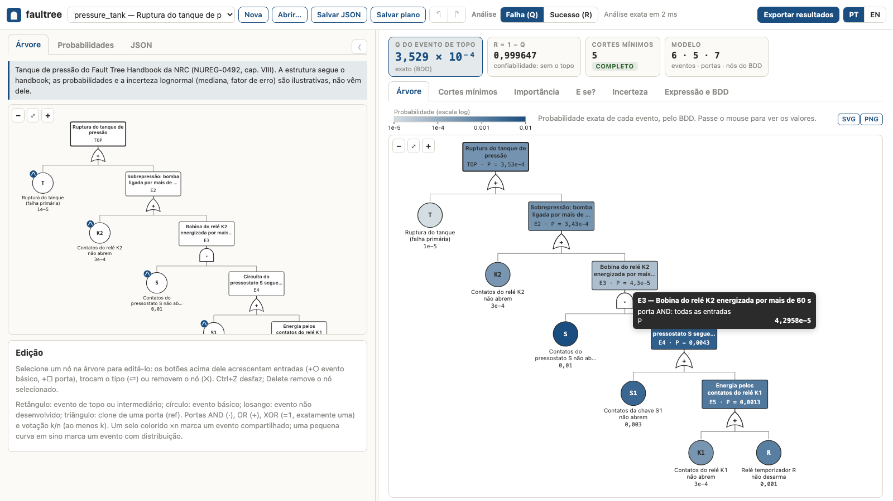

# Faultree

[](https://doi.org/10.5281/zenodo.23244049)

A Python tool for Fault Tree Analysis (FTA) using Ordered Binary Decision Diagrams (OBDD).

## Overview
- Converts a Fault Tree (FTA) JSON into an Ordered BDD using the `dd` package.
- Supports logic gates: AND, OR, XOR (exactly-one), K-of-N, INHIBIT and
  PRIORITY AND (from failure-time models, for independent modules), and
  the NUREG-0492 primary events: basic, undeveloped, house and conditioning.
- Exact top-event and intermediate-event probabilities in O(|BDD|) time
  (memoized Shannon cofactor recursion) — repeated/shared events are handled
  exactly, with no cut-set approximations.
- Reliability block diagrams (series, parallel, k-out-of-n, switches,
  repeated blocks) are analyzed as their fault trees, and models convert
  between the two forms.
- Outputs algebraic and symbolic expressions.
- Supports internal event cloning via `ref` (reference nodes), making the
  model a DAG.
- Probabilities can be scalars or sample arrays (evaluated elementwise), given
  inline, as a JSON mapping, or loaded from CSV/Excel files.

## Graphical interface

`faultree gui` (or `python -m faultree gui`) opens a local web app in the
browser: load or build a tree, give the basic events probabilities or
distributions, and explore the exact results without writing code.

```bash
faultree gui                            # http://127.0.0.1:8765/, or a free port
faultree gui --port 9000 --no-browser   # choose the port; open the page yourself
```

It runs entirely on your computer: a small standard-library server, bound to
127.0.0.1, serves the page and calls `analyze()`, `minimal_cut_sets()` and
`minimal_path_sets()`.
Nothing is loaded from the internet (it works offline) and it needs no extra
dependency. Ctrl+C stops it. The interface is in Portuguese and English: it
follows the browser's language, and the PT/EN switch changes it.



The model is on the left:

- **Tree**: the editor. Select a node to add basic events or gates, change
  the gate (AND, OR, XOR = exactly one, k-out-of-n, INHIBIT, PRIORITY AND),
  set an event's
  kind (basic, undeveloped, house = a true/false switch, conditioning = the
  condition of an INHIBIT gate), share a basic event
  between branches, or add a clone of a gate (faultree's `ref`); undo and
  redo with Ctrl+Z / Ctrl+Shift+Z. Every occurrence of a shared event, and a
  gate together with its clones, carries the same marker in a colour of its
  own (a letter A, B, C…, the colour alone, or the count ×n), and hovering or
  selecting one highlights all the others.
- **Probabilities**: the probability of every basic event, given directly or
  by a failure model at a mission time t: p = F(t) for a time to failure that
  is exponential, Weibull, normal, lognormal, gamma or uniform, or a count of
  failures reaching k (binomial over n demands, Poisson over [0, t]). In
  success mode the event value is the reliability 1 − F(t). Optionally, a
  distribution of p for the uncertainty analysis (lognormal by median and
  error factor, beta, uniform, log-uniform); a CSV/Excel probability file can
  be imported (one column per event; one row gives point values, several rows
  give joint sample vectors).
- **Blocks**: in the Blocks view, the same model drawn as a reliability
  block diagram (see below): series groups from left to right, parallel
  groups between two rails, k-out-of-n groups ending in a voter k/n, each
  group a frame named after its gate. House events are switches, a
  conditioning event is a dashed block in parallel with its INHIBIT input, a
  clone is a repeated group drawn as one block, and XOR and PAND gates are
  module blocks whose logic is in the tree view. The diagram is edited in
  place: the buttons above the selected block or group add a block in series
  or in parallel with it (a sibling in a group of that structure, else a new
  group around both), add a block to a group, change a group between series,
  parallel and k-out-of-n or a block between basic and undeveloped, and
  remove it. A k-out-of-n group keeps its number of blocks that must work
  when blocks are added or removed there (the tree view keeps k), and the
  panel below edits names, probabilities and that number. **New** in the
  Blocks view starts a diagram in success analysis, so blocks take
  reliabilities (a new block has R = 0.99); a fault tree switched to the
  Blocks view stays in failure analysis, and a reminder there switches the
  drawing between its failure probabilities P and R = 1 − P without
  changing what the inputs mean.
- **JSON**: the model in faultree's format, to edit or paste (recursive or
  flat fault tree, or RBD) and apply; in the Blocks view it shows the RBD.
- The top bar opens the examples in `examples/` and JSON files, saves the
  model as a recursive or flat fault tree or as an RBD, switches between
  failure analysis (Q) and success analysis (R, with reliabilities as inputs),
  and between the Tree and Blocks views of the same model (an RBD file opens
  in the Blocks view). The
  ⚙ button opens the settings: the shared-event marker, highlighting of
  occurrences and automatic or scientific notation (kept in the browser).

The results are on the right, recomputed as you edit:

- A summary: exact Q (or R) and its complement, the number of minimal cut
  sets with the completeness flag, the model and BDD sizes, and the
  uncertainty band once it has been run.
- **Tree** (or **Blocks**): the exact probability of every event drawn on
  the tree or the block diagram (one-hue, logarithmic colour scale), with the
  values on hover. In the block diagram every group's header carries its
  value: P that it fails, or R in success mode.
- **Cuts and paths**: the minimal cut sets in a sortable table (order,
  probability, share of Q), the largest contributions, the completeness flag
  and maximum order, and the rare-event sum and min-cut upper bound next to
  the exact Q; or the minimal path sets (the paths of the block diagram, with
  the probability that all their blocks work). Hovering a row marks its
  events on the model.
- **Importance**: Birnbaum, criticality, RAW and RRW of every basic event as
  sortable bars, and a RAW × RRW (or Birnbaum × criticality) scatter with the
  usual screening thresholds.
- **What if?**: click basic events (or blocks) to set them failed or
  working; Q and every gate are recomputed exactly, with the ratio to the
  base Q.
- **Uncertainty**: draws joint samples of the events that have a
  distribution, propagates them exactly as sample vectors, and shows the
  histogram or CDF of Q with its 5/50/95 % percentiles, mean and point value,
  and the spread of each importance measure per event. Runs are reproducible:
  each event draws from `numpy.random.default_rng([seed, zlib.crc32(event_id)])`.
- **Expression and BDD**: faultree's expression and symbolic forms and, for
  small trees, the BDD with the probability of each node (the Shannon
  recursion behind the exact result).
- **Export results** saves a JSON with the model, settings, point results,
  what-if scenario and uncertainty run; every chart has SVG and PNG buttons.

The GUI keeps an event's distribution in an `uncertainty` field
(`{"dist": "lognormal", "median": 1e-3, "ef": 3}`), its failure model in
`failure_model` (`{"dist": "weibull", "beta": 1.8, "eta": 12000}`) with
`mission_time` and `time_unit` on the top event, and an optional Portuguese
name in `name_pt`; the engine ignores them and reads `prob`, which the GUI
saves as F(t) at the mission time. `examples/pressure_tank.json` is the
pressure tank of the NRC Fault Tree Handbook (NUREG-0492), with illustrative
probabilities; `examples/cooling_system.json` uses every kind of failure
model. More screenshots are in [docs/gui](https://github.com/jmateusms/faultree/tree/main/docs/gui).

## Installation

Requires Python ≥ 3.10.

```bash
pip install faultree            # library + CLI (needs only dd and numpy)
pip install "faultree[server]"  # + FastAPI/uvicorn for the API server
pip install "faultree[excel]"   # + pandas/openpyxl to read Excel probability files
```

CSV probability files need no extra dependency. faultree uses `dd.autoref`,
the pure-Python BDD backend of `dd`, so no C compiler or CUDD is needed at
run time, which also lets it run in the browser under Pyodide. PyPI has only
Linux wheels and the source of `dd`; for Pyodide, build a pure-Python wheel
first with `pip wheel dd --no-deps --no-binary dd`.

From a checkout of this repository:

```bash
pip install -e ".[server,test]"
```

## Tree Format
- **Fields**:
  - `id` (string): Unique identifier for the event.
  - `name` (string): Descriptive name.
  - `event_type`: `top`, `intermediate`, `basic`, `undeveloped`, `house` or
    `conditioning`.
  - `gate`: `AND`, `OR`, `XOR`, `K_OF_N`, `INHIBIT`, `PAND`, or `null`/`BASIC`
    for leaves.
  - `children` (list): Child nodes.
  - `k` (int): Required for `K_OF_N` gates (`0 <= k <= n`).
  - `prob` (finite float or non-empty list of finite floats): Probability for
    basic, undeveloped and conditioning events. A list is treated as a
    one-dimensional sample vector and propagated elementwise.
  - `state` (bool): Required for `house` events, which take no `prob`.
  - `failure_model` (object): Time-to-failure model, e.g.
    `{"dist": "weibull", "beta": 1.5, "eta": 30000}`. Required for events
    under a `PAND` gate; elsewhere the engine reads `prob`.
  - `mission_time` (number, top event): Required when the tree has a `PAND`.
  - `ref` (string): ID of another node to clone/reference.
  - `prob_file` (string, optional, top level): CSV/Excel file with one column
    per basic-event id, resolved relative to the tree JSON.

Gate semantics: `XOR` means **exactly one** input (a mutually-exclusive gate),
not chained parity. `K_OF_N` means **at least k** of the n inputs.

The other symbols of the NRC Fault Tree Handbook (NUREG-0492):

- A **house** event (the handbook's external event) is a switch: `state:
  true` means the event occurred, `false` that it did not. It is a constant
  in the BDD, not a variable, so it needs no probability and has no
  importance or cut-set entry. Use it to model configurations, such as a
  train in maintenance, and change `state` to compare them.
- An **INHIBIT** gate has exactly two inputs: the input event and one
  **conditioning** event, the enabling condition. The output occurs when
  the input occurs and the condition holds. The conditioning event's `prob`
  is the probability of the condition *given the input*, so
  P(output) = P(input) · P(condition | input) exactly. A conditioning
  event belongs to one INHIBIT gate: it cannot appear elsewhere or be
  shared by `ref`. The INHIBIT gate itself can be shared, by `ref` or by
  repeating it with the same id (as the flat format does). The conditioning event is
  otherwise an ordinary variable, with importance measures and a place in
  the cut sets. Expressions show the gate as AND.
- An **undeveloped** event is a basic event whose causes are not developed
  further; it differs only in the drawing.
- **Transfer** in/out symbols are a drawing convention; `ref` gives the
  same sharing within one file.

`examples/nureg_symbols.json` uses all of them.

A **PRIORITY AND** gate (`PAND`) occurs when all its inputs occur by the
mission time, in order from left to right. A Boolean variable says whether
an event occurred, not when, so faultree quantifies each PAND as an
independent module and puts it into the BDD as one variable:

- Every event under the gate needs a time-to-failure `failure_model`
  (exponential, weibull, normal, lognormal, gamma, uniform, or poisson for
  the time of the k-th failure), and the top event a `mission_time`. House
  events are allowed; inside the gate only AND, OR, K_OF_N and PAND gates are.
- A house event that has occurred (`state: true`) occurs at time 0, and
  inputs that occur at the same time are not in order. With such an event
  H, PAND(A, H) = 0 and PAND(H, A) = P(0 < T_A ≤ t). A house event that has
  not occurred never occurs.
- The inputs share no events with each other, and no event under the gate
  appears elsewhere in the tree. The gate itself may be shared by `ref`.
- Each input's failure-time CDF F_i(s) comes from its model, or for a
  subtree from its BDD evaluated on a time grid. Then G_1 = F_1 and
  G_k(s) = ∫₀ˢ G_{k-1}(u) dF_k(u) (trapezoidal Stieltjes sums, Richardson
  extrapolation), and P(PAND) = G_n(mission_time). Each outermost PAND
  gate has its own grid: uniform, with intervals halved where one of its
  events' CDFs rises steeply or bends (a failure time much shorter than the
  mission time, a narrow distribution or its tail); at time 0 down to float
  resolution, for a CDF singular at 0 (Weibull or gamma shape below 1). The
  error estimate is the difference between the grid and the half grid, or
  more where a CDF still bends within an interval. An interval the grid
  cannot resolve (a nearly deterministic failure time) adds a bound to the
  estimate; when consecutive inputs fail within such an interval, so that
  their order cannot be resolved, it is an error. Two limits: a narrow
  distribution whose tail just reaches the mission time (mass below about
  1e-3 there) is not refined, so a very small P(PAND) can have a large
  relative error, which the estimate shows (a larger `pand_steps` resolves
  it); and two consecutive inputs whose CDFs are concentrated at time 0
  (gamma shapes below about 0.04 to 0.07, depending on the scale next to
  the mission time; Weibull shapes below about 0.01) cannot be ordered and
  are an error.
- `analyze(..., pand_steps=4096)` sets the uniform grid; `assumptions["pand"]`
  reports each gate's value, an error estimate and the number of grid
  points. The PAND id is the event in cut sets, importance and what-if;
  events inside it get their probability at the mission time, so a
  probability given for one of them (`--probs`, a probability file) is an
  error. Expressions show `PAND(A, B)`.

`examples/priority_and.json` uses it. Standby and spare structures, where
the same component appears inside and outside the ordered gate, are not
independent modules and are rejected.

## Reliability block diagrams

A model can also be a reliability block diagram (RBD), marked by
`"model": "rbd"`. A block works when its component works, and the system
works when a path of working blocks joins the input to the output. faultree
analyzes an RBD as its fault tree, so the analyses, the CLI, the API server
and the GUI accept it:

```json
{"model": "rbd", "id": "SYS", "structure": "series", "blocks": [
  {"id": "PS", "name": "Power supply", "prob": 1e-4},
  {"id": "PUMPS", "structure": "parallel", "blocks": [
    {"id": "PA", "prob": 0.01}, {"id": "PB", "prob": 0.01}]},
  {"structure": "k_of_n", "k": 2, "blocks": [
    {"id": "S1", "prob": 0.005}, {"id": "S2", "prob": 0.005},
    {"id": "S3", "prob": 0.005}]}]}
```

| RBD | Fault tree |
| --- | --- |
| `series` group | OR gate |
| `parallel` group | AND gate |
| `k_of_n` group: at least `k` of n blocks work (k-out-of-n:G) | `K_OF_N` with k = n − k + 1 (failures) |
| block; `kind: "undeveloped"` optional | basic or undeveloped event |
| `switch`: `"open"` (the path is cut) or `"closed"` (a wire) | house event, `state` true or false |
| `parallel` group of an input and a block of `kind: "conditioning"` | INHIBIT gate |
| `{"ref": id}`: a repeated block or group | `{"ref": id}` |
| `{"fault_tree": node}` | that fault-tree node, unchanged |

- A block's `prob` is the same input as an event's `prob`: a failure
  probability, or a reliability with `--reliability` (`success_mode=True`).
  Blocks take the other event fields (`failure_model`, `uncertainty`,
  `name_pt`).
- Groups take `id`, `name` and `name_pt`. The top group needs an `id`; an
  unnamed group gets `<parent id>.<position>`, e.g. `SYS.3`. Results, cut
  sets and importance measures use these ids.
- XOR (exactly one input fails) has no RBD form. It is not coherent:
  repairing a component can make it occur, and no arrangement of blocks
  does that. A PRIORITY AND depends on the order of the failures, which a
  static diagram does not record. Both stay fault-tree logic inside a
  `{"fault_tree": node}` block, which can also hold any other fault-tree
  node.
- A bridge, or another network that is not series-parallel, can be written
  as the parallel of its minimal paths with repeated blocks
  (`examples/rbd_bridge.json`). The result is exact, because a repeated
  block is one event.
- `rbd_to_tree(rbd)` and `tree_to_rbd(tree)` convert between the two forms.
  A fault tree converted to an RBD and back keeps its gates, ids and
  probabilities.
- `minimal_path_sets(model)` lists the minimal sets of events whose
  non-occurrence keeps the top event from occurring: for an RBD, the minimal
  sets of working blocks that keep the system working. They are built
  top-down (an OR gate needs a path of every input, an AND gate a path of any
  input), so a long series system costs no more than its one path. Sets
  longer than `max_order` (default 10) are left out; a family that grows past
  `max_family` sets lowers that limit. A list from which nothing was left
  out is complete; otherwise `complete` is checked on the BDD, and an
  incomplete list is complete up to `complete_to_order`.

`examples/rbd_cooling.json` uses every element. The GUI draws any model as a
block diagram (the Blocks view) and saves it as an RBD.

Every basic event must have a probability (from the tree, `--probs`, or a
probability file); a missing probability is an error unless
`--assume-missing-zero` is passed.

## Supported Formats
Faultree supports two JSON formats (auto-detected):
1. **Recursive Tree** (standard): Nodes nested within `children`.
2. **Flat List**: Nodes defined in `ft_nodes` and `be_nodes` lists, with
   `branches` referencing child IDs.

Event IDs must identify one definition. Repeating an identical definition is
accepted as an inline copy of the same event; conflicting repeated definitions
are rejected. A flat model must provide an explicit `analysis`/`esd_nodes`
root or have exactly one unreferenced root, and every declared node must be
reachable from it.

## Usage

```bash
faultree examples/basic_tree.json
# or equivalently
python -m faultree examples/basic_tree.json
```

Override probabilities (inline JSON or a CSV/Excel path):

```bash
faultree examples/basic_tree.json --probs '{"BE1": 0.05}'
faultree examples/fta4b.json --probs examples/fta4b_probs.csv
```

A probability CSV has a header row of basic-event ids and one row per sample.
Columns may be separated by `,`, `;` or a tab; with `;` or a tab, decimal
commas (`0,05`) are read as well, which is what Excel writes in pt-BR and
other comma-decimal locales. The `.csv`/`.xlsx` extension is not
case-sensitive.

Reliability analysis (dual/success tree). The tree keeps its failure-logic
structure, but inputs are interpreted as reliabilities and the result is the
system success probability `R = 1 - Q`:

```bash
faultree examples/fta3_success.json --reliability
```

Structured JSON (top-event probability, conditional probabilities, importance
measures and the assumptions used) and minimal cut sets:

```bash
faultree examples/fta4.json --structured
faultree examples/fta4.json --cut-sets        # optional max order, default 6
```

Reliability block diagrams (see above), conversion and path sets:

```bash
faultree examples/rbd_cooling.json                # analyze a block diagram
faultree examples/pressure_tank.json --to-rbd     # print a fault tree as an RBD
faultree examples/rbd_bridge.json --to-ft         # print an RBD as a fault tree
faultree examples/rbd_bridge.json --path-sets     # optional max order, default 10
```

JSON output is strict: non-finite values (for example an infinite risk
reduction worth when one event alone guards the top event) are written as
`null`.

Run the API server (binds to `127.0.0.1` by default; pass `--host 0.0.0.0`
to expose it):

```bash
faultree --serve
```

**Example request**:

```bash
curl -X POST http://localhost:8000/analyze \
  -H "Content-Type: application/json" \
  -d '{
    "tree": {
      "id": "TOP",
      "gate": "OR",
      "children": [
        {"id": "A", "prob": 0.1},
        {"id": "B", "prob": 0.2}
      ]
    }
  }'
```

## Features
- **Logic Gates**: AND, OR, XOR (exactly one), K-of-N (at least k), INHIBIT,
  PRIORITY AND (independent modules, from failure-time models); house
  (switch) and conditioning events.
- **Exact quantification**: weighted model counting via the BDD cofactor
  recursion — linear in BDD size, exact for repeated/shared events.
- **Importance measures** (`analyze()`, `--structured`; fault-tree mode):
  Birnbaum, criticality `(Q − Q0)/Q`, risk achievement worth (RAW) and risk
  reduction worth (RRW), computed exactly on the BDD for every basic event,
  also elementwise for sample vectors. Criticality equals the risk-decrease
  form that PRA codes often call Fussell-Vesely (`1 − 1/RRW`); Fussell's
  cut-set definition is larger and agrees with it only for rare events.
- **Minimal cut sets** (`minimal_cut_sets()`, `--cut-sets`): bounded
  enumeration for monotone AND/OR/K-of-N trees, with an explicit
  completeness flag.
- **Dual tree mode**: reliability/success probability from the same tree.
- **Reliability block diagrams**: series, parallel, k-out-of-n:G groups,
  switches, repeated blocks and fault-tree blocks, analyzed as their fault
  trees; `rbd_to_tree()`/`tree_to_rbd()` (`--to-ft`/`--to-rbd`) and minimal
  path sets (`minimal_path_sets()`, `--path-sets`).
- **Sampled probabilities**: equal-length array-valued probabilities are joint
  samples and propagate elementwise. Unequal lengths are rejected by default;
  `--resample-independent` explicitly bootstraps independent marginals and
  therefore discards joint alignment. `--shuffle` uses a shared permutation.
- **Symbolic output**: algebraic expressions (e.g. `(A + B * C)`).
- **Ref/clones**: reuse events within the same tree using `{"ref": "ID"}`
  (cycles are detected and rejected).
- **API**: FastAPI server (`/analyze`, `/health`) for integrating with other
  tools.
- **GUI**: `faultree gui`, a local web interface (standard library only).

## Development

```bash
pip install -e ".[server,test]"
python -m pytest
```

`tests/test_auto_examples.py` cross-checks every example tree against an
independent brute-force oracle; `tests/test_examples.py` pins hand-computed
golden values; `tests/test_fixes.py` covers regression cases (success-mode
XOR duality, cycle detection, input validation, server behavior).

## Backlog
- **Minimal Cut Sets at scale**: ZBDD-based extraction beyond the bounded
  enumeration.
- **Variable Ordering**: Heuristics and `dd` sifting for BDD size reduction.
- **Time-Dependent Analysis**: the GUI computes event probabilities from
  failure models at one mission time; next: Q(t) curves, repairable
  components (availability), failure models in the engine and CLI, and
  uncertainty on model parameters (e.g. on λ).
- **Sound Uncertainty Propagation**: jointly sampled Monte Carlo / LHS with
  percentile bounds (replacing per-event resampling).
- **Common-Cause Failure**: beta-factor / MGL / alpha-factor groups.
- **Transfer Symbols**: Split trees across multiple files (`transfer_in`).
- **Dynamic gates**: spare, sequence and functional-dependency gates, and
  PRIORITY AND gates that share events with the rest of the tree (Markov or
  sequence-BDD methods); uncertainty on failure-model parameters.
- **Open-PSA MEF**: import/export for ecosystem interoperability.
- **Reliability block diagrams**: network diagrams (bridges) given as blocks
  and connections, compiled through their minimal paths, with a graph editor
  in the GUI.
- **Frontend**: the local GUI (`faultree gui`) covers editing, exact results,
  cut sets, importance, what-if and uncertainty. Next: navigation of large
  trees (collapse branches, search), state-of-knowledge correlation between
  identical components in the uncertainty analysis, and a Pyodide build that
  needs no local server.

## Notes
- Assumes independent basic events.
- Variable ordering is based on traversal order unless specified with
  `--ordering` (which must cover all basic events).
- The engine (and the underlying `dd` library) is recursive: extremely deep
  trees/BDDs (~1000 levels) can hit Python's recursion limit.

### Bounded monotone minimal cuts

`minimal_cut_sets(tree, max_order=6, max_candidates=10000, max_sets=1000,
max_basic_events=32)` returns positive minimal cuts for AND/OR/K_OF_N/INHIBIT
models (house events are constants and never appear in a cut; a PAND gate
appears as one event).
Always inspect `complete`, `truncated` and `reason`; an incomplete list is not
an exhaustive reliability result. XOR needs signed implicants and is rejected.
Limits apply to enumeration, not a hard wall-clock or BDD-memory budget.

## Citing

If you use faultree in academic work, please cite it: GitHub's **Cite this repository** button (from [CITATION.cff](https://github.com/jmateusms/faultree/blob/main/CITATION.cff)) gives APA and BibTeX. Releases are archived on Zenodo: [doi:10.5281/zenodo.23244049](https://doi.org/10.5281/zenodo.23244049) cites the software across versions, and each release has its own DOI on that page.

## License

BSD 3-Clause — see [LICENSE](https://github.com/jmateusms/faultree/blob/main/LICENSE).
